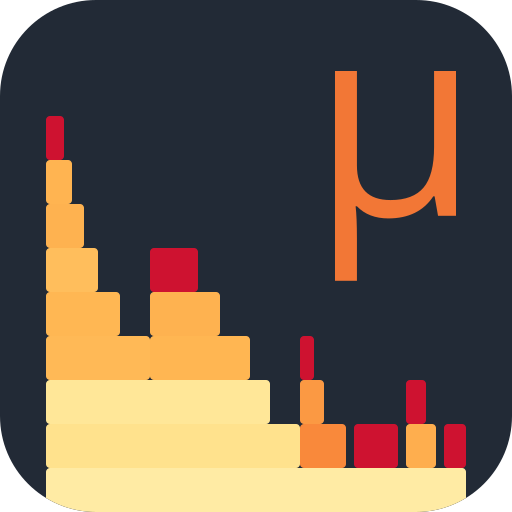

# amd-uprof plugin

AMD uProf profiling for Claude Code. Capture CPU time on AMD Zen, symbolize it, and answer
where the cycles go — with shares by process, function, source line or instruction.

## What it does

- Captures with AMD uProf's CLI: PMCx076 `CYCLES_NOT_IN_HALT` cycle sampling, system-wide or
  attached to PIDs; IBS OP sampling with an op-count or cycle-controlled interval. IBS fetch
  dumps can be translated and profiled but are not a capture choice.
- Symbolizes with llvm-symbolizer: PDB data on Windows, DWARF on Linux, down to file/line and
  instruction attribution. ICF-folded addresses are labelled shared instead of being credited
  to one name.
- Profiles by process, function, source line or instruction. IBS dumps get exact DeltaTick-gap
  time weighting, so the time share is elapsed core time and not a sample count; op-count
  sample shares are instruction shares, and the two are never conflated.
- Queries the capture in DuckDB, with the schema and views shipped as `tools/views.sql`.
- Anchors a workload's QueryPerformanceCounter reading to capture-relative seconds; a negative
  value is attach latency, not the workload's own start.
- Prints `SANITY` and `ACHIEVED` before the shares: the dump's provenance against the capture
  span, and the rate actually delivered against the requested interval.

## What it is good for

- Cycle-based hot spots: what burns CPU and where, at function, line and instruction
  granularity.
- Spin versus compute, and instruction mix on IBS OP captures.
- Whole-machine profiles when the target is not known in advance, or a process cannot be
  attached; attach PIDs when the question is about one program.
- Correlating a workload's own clock with the capture, so a phase can be queried by
  capture-relative time.
- Captures that are kept and queried later: a session is a DuckDB database, not a bespoke
  report.

## Requirements

- AMD uProf CLI (`AMDuProfCLI`).
- DuckDB 2.x Python package.
- llvm-symbolizer; on Windows, llvm-pdbutil and llvm-readobj enable shared-address labelling.

`tools/uprof.py tools` prints every resolved path and version, and fails only when a required
tool is missing. Windows is the verified host; the Linux branch is kept but unverified on the
reference host.

## Install

    claude plugin marketplace add Ext3h/amd-uprof-plugin
    claude plugin install amd-uprof@amd-uprof-dev

## Commands

The skill runs `tools/uprof.py`:

| Command | Use |
|---|---|
| `collect` | capture cycle or IBS OP samples, system-wide or attached |
| `translate` | symbolize a capture on a copy; optionally write the IBS ASCII dump |
| `profile` | samples and time shares by process, function, line or instruction |
| `anchor` | map a QPC reading to capture-relative seconds |
| `schema` | print the live DuckDB schema for drift checks |
| `tools` | print resolved tool paths and versions |

`SKILL.md` in `skills/amd-uprof/` is the entry point and the full contract; `references/`
carries the derivation notes and measured validation figures.

## Layout

- `skills/amd-uprof/` — the skill, its tools and references.
- `.claude-plugin/` — manifest, marketplace entry, and the icon (`icon.svg` master, `icon.png`
  raster).

Validate a change with `claude plugin validate .`.

Drives the AMD uProf CLI; not affiliated with or endorsed by Advanced Micro Devices.
The icon's micro sign is set in Open Sans (Apache-2.0), the typeface uProf ships.
